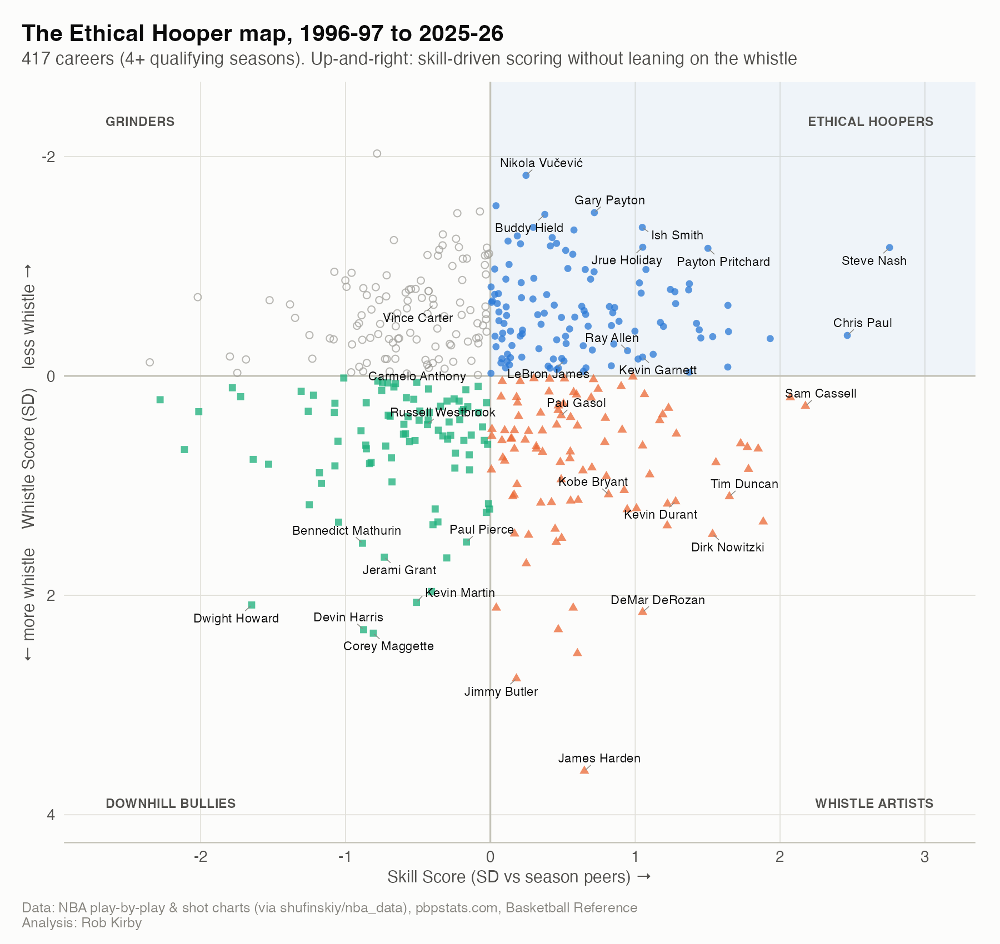

# The Ethical Hooper Index

**Which NBA scorers, 1996-97 to 2025-26, generate offense through skill rather than the whistle?** A reproducible R + Quarto analysis of every shot, foul and free throw in thirty seasons of NBA play-by-play.

**Live site:** https://USERNAME.github.io/ethical-hooper-index/



## What is an ethical hooper?

Basketball slang for a player who scores and dominates through pure skill, clean footwork, natural shot-making and fluid movement, rather than trickery, flopping or foul-baiting: no rule manipulation, an aesthetic playstyle, and low free-throw reliance relative to scoring volume.

Measured here as **high shot-making relative to shot difficulty, self-created offense, clean footwork, and low dependence on free throws not explained by an aggressive, rim-attacking shot diet.**

> This is a **stylistic** metric built only from on-court data. It is not a moral judgment of any person; drawing fouls is legal and often smart basketball.

## Key findings

- **Most ethical careers:** Steve Nash, Payton Pritchard, Ish Smith, Nikola Vučević, Chris Paul. **Most whistle-dependent:** James Harden, Dwight Howard, Corey Maggette, Devin Harris, Jimmy Butler.
- **A persistent style:** a player's EHI correlates r = 0.74 with the next season's (2,708 pairs).
- **The 2021-22 "non-basketball move" crackdown** cut league three-point shooting fouls from 1.42 to 1.08 per 100 attempts in one season. Players with higher pre-rule Whistle Scores lost 0.38 points of true shooting per SD afterward (p = 0.049); a placebo rule date shows no effect (p = 0.814).
- **4,022 qualifying player-seasons and 417 careers** ranked; full tables in [`data/final/`](data/final/).

## Method in brief

1. **Data:** NBA.com play-by-play and shot charts 1996-97 to 2025-26 (regular season + playoffs) from the [`shufinskiy/nba_data`](https://github.com/shufinskiy/nba_data) archive; official minutes and positions from Basketball Reference; possessions from pbpstats.com.
2. **Expected FG model:** xgboost on shot location, distance, shot family, motion, clock and season (never shooter identity); held-out 2025-26 log-loss 0.639 vs 0.657 for a zone-average baseline; cross-fitted by game.
3. **Skill Score:** shot-making above expected, self-creation (unassisted makes), shot difficulty, clean footwork (travels + offensive fouls).
4. **Whistle Score:** excess free-throw rate (beyond what shot diet, usage and position predict), three-point shooting-foul rate, free-throw share of points, perimeter and-one rate.
5. **Empirical-Bayes shrinkage**, within-season z-scores, then **EHI = 0.4 × Skill − 0.6 × Whistle** on a 0–100 scale (50 = average qualifier).
6. **Validation:** cross-checks vs Basketball Reference and pbpstats, year-to-year stability, sensitivity to weights, and a difference-in-differences / event study of the 2021-22 rule change with placebo and regression-to-the-mean checks.

Full details: the [Methodology](analysis/methodology.qmd) page and the running decision log in [`NOTES.md`](NOTES.md).

## Reproduce it

Requirements: R ≥ 4.5 and the [Quarto CLI](https://quarto.org) (≥ 1.11).

```r
# from the repository root
install.packages("renv")
renv::restore()          # installs the exact package versions in renv.lock
```

```sh
Rscript run_all.R          # full rebuild: download, clean, model, index, site (~45 min)
Rscript run_all.R --site   # only re-render README + site from the committed data/final/
```

Raw and intermediate data (`data/raw/`, `data/interim/`, ~4 GB) are not committed; `R/01_download.R` recreates them from the public sources, caching everything so nothing downloads twice.

## Repository structure

```
R/01_download.R            cached downloads (bulk PBP, pbpstats, Basketball Reference)
R/02_clean_pbp.R           shots, free-throw trips, player counting stats
R/02b_external_sources.R   official minutes/positions, ID map, player-season table
R/03_shots_xfg_model.R     expected-FG model + evaluation
R/04_player_metrics.R      the eight components + empirical-Bayes shrinkage
R/05_index_build.R         z-scores, composite, archetypes, careers, sensitivity
R/06_validation.R          cross-source checks, stability, face validity
R/07_rule_change_did.R     2021-22 rule change: DiD + event study
R/08_eras_anomalies.R      eras, anomalies, signature charts
R/utils.R                  paths, helpers, palette, ggplot theme
analysis/                  Quarto site source (rendered to docs/)
data/final/                small committed outputs (CSV)
data/audit/                data-audit and QA tables
figures/                   all charts (PNG)
scripts/                   README builder, optional tracking-data loader
NOTES.md                   decision log, data quirks, open questions
```

## Limitations

- No defender-distance data before 2013-14: xFG knows where and how a shot was taken, not how contested it was.
- Shooting fouls on missed twos can't be located on the court; jump-shot foul-baiting on twos shows up only through and-ones and the excess-FT residual.
- Officiating varies by crew and season; within-season standardization removes league-wide shifts only.
- NBA player-tracking validation (Tier 2) is pending: the NBA stats API blocks automated access.
- The index measures playing style, not character.

## Data sources & credits

- NBA.com play-by-play and shot detail via [shufinskiy/nba_data](https://github.com/shufinskiy/nba_data)
- [Basketball Reference](https://www.basketball-reference.com) (Sports Reference LLC): minutes, positions, cross-check tables
- [pbpstats.com](https://www.pbpstats.com): possessions and cross-check totals
- R packages: data.table, arrow, xgboost, fixest, ggplot2, ggrepel, gt, reactable, and more (see `renv.lock`)

## Author

**Rob Kirby**, Economics / Finance / Business Analytics. Questions and feedback welcome via GitHub issues.

Licensed under the [MIT License](LICENSE).
